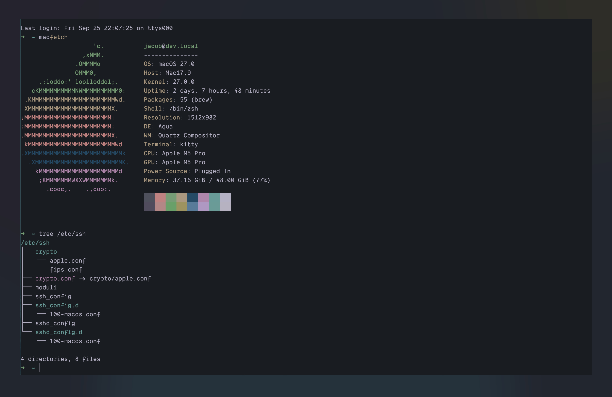

# Alacritty

Place the `themes/lock-wood.toml` file in `$HOME/.config/alacritty/themes/`.

Then, open `$HOME/.config/alacritty/alacritty.toml` and add the following lines
at the top:

```toml
[general]
import = ["~/.config/alacritty/themes/lock-wood.toml"]
```

Save the file. Alacritty reloads its configuration automatically.

<p align="center">
  
</p>
